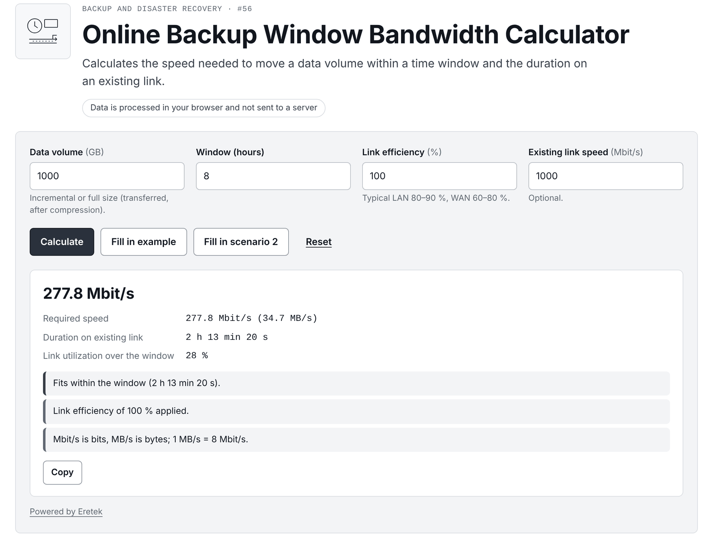

# Backup Window Bandwidth Calculator

Calculate the bandwidth (Mbit/s, MB/s) needed to move a data volume within a backup window and, with a link speed, the transfer time and whether it fits.

## Try it live

- [Türkçe](https://sistem.eretek.com/araclar/yedekleme-penceresi-bant-genisligi)
- [English](https://sistem.eretek.com/en/tools/backup-window-bandwidth)
- [Deutsch](https://sistem.eretek.com/de/werkzeuge/backup-fenster-bandbreite)



## What it does

Calculates the speed needed to move a data volume within a time window and the duration on an existing link.

If the nightly backup runs into business hours users notice; if the copy to a remote site falls behind, RPO breaks. The tool accounts for bits vs bytes and link efficiency to give required speed and duration.

## Where it helps

If it does not fit: move to incrementals, use WAN acceleration/deduplication, split jobs or seed the first full with a portable disk.

## How to use it

1. Enter the data volume (GB) and backup window (hours).
2. Enter link efficiency (protocol, latency, sharing losses) and, if known, the existing link speed; press Calculate.

### Fields

| Field | Description |
|---|---|
| Data volume | Incremental or full size (transferred, after compression). |
| Window (hours) |  |
| Link efficiency | Typical LAN 80–90 %, WAN 60–80 %. |
| Existing link speed | Optional. |

## Example input

Press **Fill in example** in the tool to load this input.

| Input | Value |
|---|---|
| Data volume | `1000` |
| Window (hours) | `8` |
| Link efficiency | `100` |
| Existing link speed | `1000` |

**Expected result:** Moving 1,000 GB in 8 hours needs 277.8 Mbit/s (34.7 MB/s); on a 1 Gbit/s link at 100 % efficiency it takes 2 h 13 min.

## Method and assumptions

Required Mbit/s = GB × 8 × 1000 / (hours × 3600) / efficiency. Duration = GB × 8000 / (link × efficiency) seconds. 1 GB = 10<sup>9</sup> bytes.

## Limits and common mistakes

- Latency impact on TCP window, parallel streams and source/target disk speeds are not modelled.

## Run it locally

The tool is plain HTML, CSS and JavaScript with no build step and no dependencies.

```bash
git clone https://github.com/eretek/backup-window-bandwidth.git
cd backup-window-bandwidth
node scripts/serve.js        # or: python3 -m http.server 8080
```

Open <http://127.0.0.1:8080/>. Add `?lang=tr` or `?lang=de` for Turkish or German; without it the page follows the browser language and falls back to English. You can also open `index.html` directly from disk.

Run the tests (Node.js 18 or later):

```bash
node test/run.js    # or: npm test
```

The tests run the tool's own fixtures and the worked examples in all three languages without a browser.

## How it works

All processing happens in your browser. The tool makes no network requests, uses no cookies or browser storage, and does not upload files you select.

No server-side component is needed. The version on the Eretek website renders the same page through a private WordPress plugin; that plugin only produces the page markup and is not part of this repository.

| Path | Purpose |
|---|---|
| `index.html` | Page shell |
| `src/app.js` | Builds the page in Turkish, English or German from `src/data.js` |
| `src/data.js` | Field definitions, examples and all texts in three languages |
| `src/core.js` | Shared runtime: validation, number formats, result rendering, CSV/ICS export |
| `src/tool.js` | The calculation or analysis for this tool |
| `docs/screenshot.png` | Screenshot used in this README |
| `src/tools.css`, `src/page.css` | Styles |
| `test/run.js`, `test/cases.json` | Headless tests |

## License and attribution

This tool is released under the [Eretek Website Attribution License](LICENSE). You may use, modify and redistribute it, including commercially. If you make it available on a website or web application, show a visible, clickable credit linking to https://eretek.com/ on every page where the tool is available, for example:

```html
<a href="https://eretek.com/">Powered by Eretek</a>
```

You may add `rel="nofollow"` to the link. Keep the copyright notice and license text in copies and redistributions.
